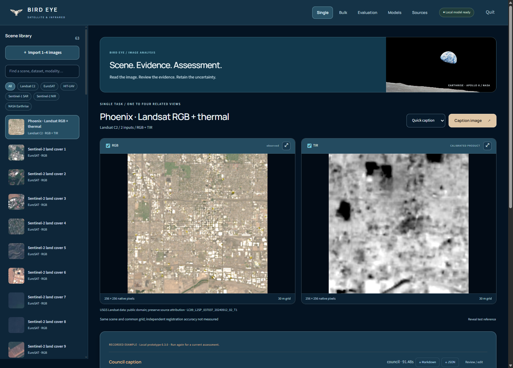
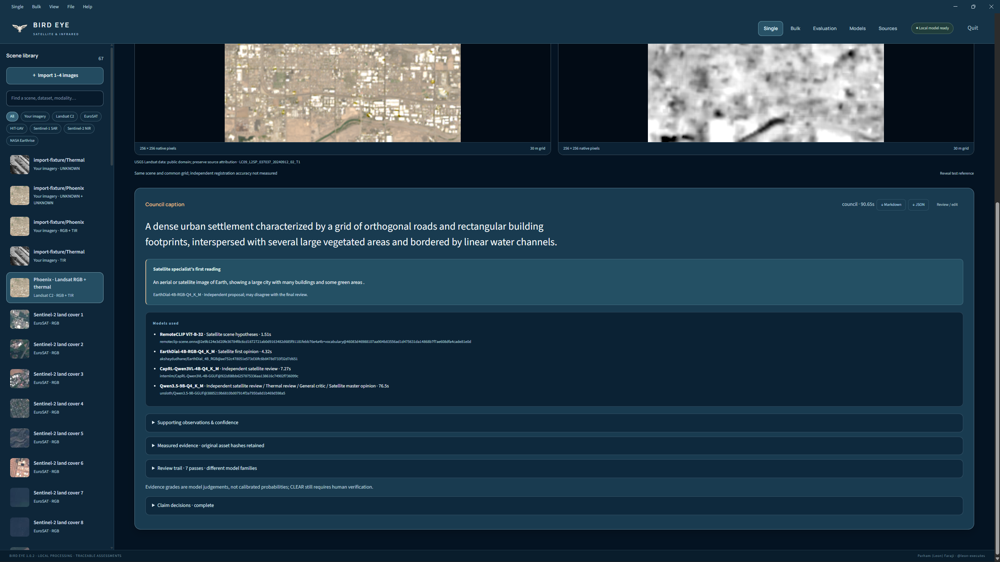
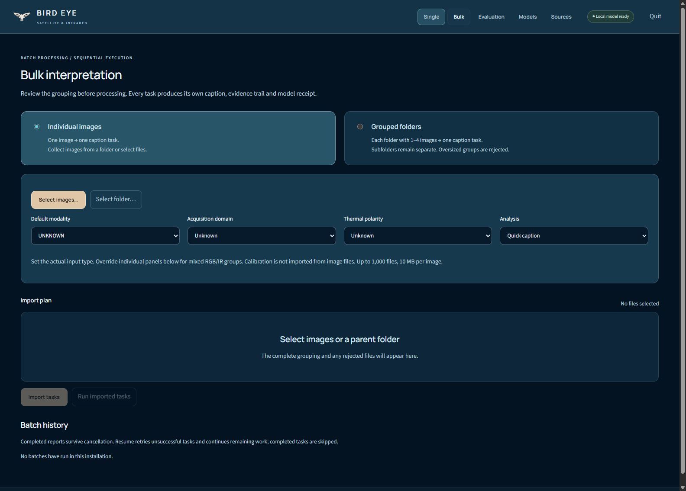
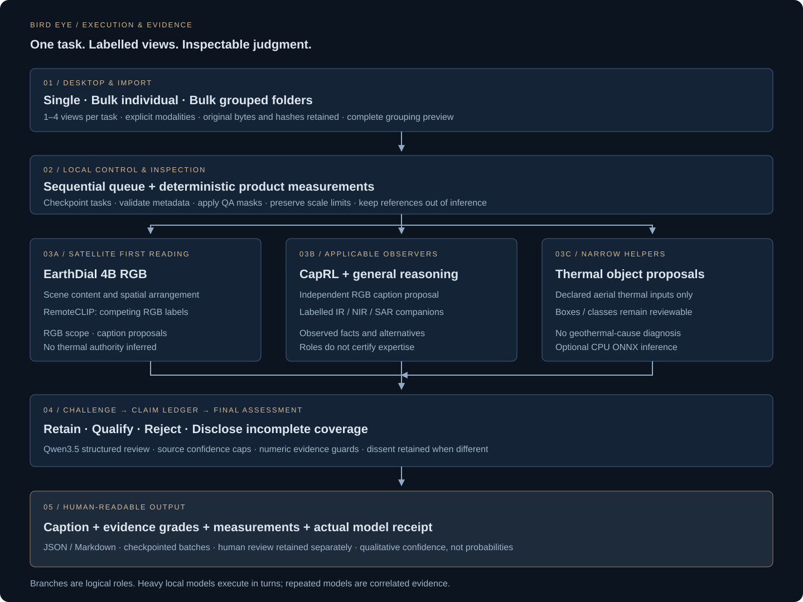

<h1 align="center">Bird Eye</h1>

<strong>Scene interpretation. Evidence retained.</strong> Satellite, infrared, RGB and related imagery - local desktop analysis.

Windows x64 · One to four views per task · Single and bulk processing · Traceable model receipts

Bird Eye turns IR & RGB satellite images into succinct scene descriptions and inspectable assessments. Using an intelligent council of experts methodology, it combines remote-sensing
caption specialists, general visual reasoning, narrowly scoped helpers and deterministic measurements.
It preserves uncertainty and competing readings instead of treating agreement as proof.

The desktop application includes its own Chromium renderer and a private loopback Node service. It opens
in a dedicated Windows window; no separate browser, Python installation or system Node installation is
needed for a portable release. Model weights are a separate component of the public distribution.

Created by **[Parham (Leon) Faraji](https://github.com/leon-executes)** · **[@leon-executes](https://github.com/leon-executes)**.
Original application code: **[PolyForm Noncommercial 1.0.0](LICENSE)**.
Processing is local by default. No telemetry service. Explicit remote model connections send images to the configured endpoint.

[Run](#run) · [Single and bulk](#single-and-bulk) · [Architecture](#architecture) · [Models](#model-responsibilities) · [Samples](#included-samples) · [Evidence](#what-the-results-mean) · [Build](#build-and-release) · [License](#license)

## Complete model setup and optional detector

The public release is the app ZIP plus **12 model parts**, each below 2 GB. Setup verifies and restores the complete council. No additional model quantization or training was applied. [Download architecture and compression results](docs/MODEL_DISTRIBUTION.md).

An optional separately installed detector can submit object classes, candidate counts and boxes. The master records explicit decisions; accepted contributions must survive into final findings. The personal edition includes this provider; the public edition includes only the client and source integration example. [Integration and use](docs/EXTERNAL_DETECTOR.md).

## Run

1. Extract **BirdEye-1.0.2-Windows-x64.zip** into a writable folder.
2. Keep the extracted folder together, including **_internal**.
3. Run **Setup models.cmd** for the complete council, then open **Bird Eye.exe**. Place downloaded model parts beside the executable for offline setup.
4. Select a sample or import **1–4 related images**. Declare each panel's actual modality.
5. Choose **Quick caption** or **Council review**, then **Caption image**.
6. Read the caption and **Models used**. Expand evidence and uncertainty; export Markdown or JSON.

The public ZIP includes **63 cited sample scenes / 77 panels** and a marked recorded assessment. It opens
without downloads. New inference requires locally installed model weights or a configured endpoint.
The **personal full package** contains the existing local model roster and runs without downloading weights.
That personal package is not cleared for public redistribution.

For the public package, **Setup models.cmd** restores Qwen3.5, CapRL, EarthDial and RemoteCLIP from the verified release parts after an explicit choice. Place the parts beside the executable for offline setup.
The full default roster is preserved; unavailable models are reported, never presented as executed experts.
See [model setup](docs/MODELS.md), [operating guide](docs/OPERATIONS.md), and [third-party notices](docs/THIRD_PARTY.md).

## Single and bulk

| Mode | Input contract | Result |
|---|---|---|
| Single | One to four related images; each panel labelled RGB, TIR, NIR, SAR, MISC or UNKNOWN | One caption and assessment |
| Bulk → Individual images | Selected files, or supported images recursively collected from a folder | One task per image |
| Bulk → Grouped folders | Every directory containing one to four images is a task; nested folders remain separate | One task per folder |
| Evaluation | Up to twelve library scenes; optional Quick + Council comparison | Saved reports and diagnostic comparison |

Bulk import shows the complete plan before processing. Groups exceeding four images are rejected,
not silently divided. Non-image files are listed as ignored. Set a common modality, then override
individual panels for mixed RGB/IR groups. Import and inference run sequentially.

Batches checkpoint progress. Cancellation keeps completed reports; **Resume unfinished** retries failed
or remaining tasks. **Export JSON** includes the batch and all completed reports. Input files are not modified.

**Quick caption** gives the first applicable model's direct reading. **Council review** adds applicable
independent readings, helper proposals, challenges and adjudication. Multiple stages can reuse a model;
the receipt exposes that relationship. More stages do not guarantee a more accurate caption.

## Architecture

### Stage ownership

| Stage | Technology / contract | Responsibility |
|---|---|---|
| Desktop shell | Electron 45.0.0, Windows x64; sandboxed renderer, context isolation | Native window and menus, file dialogs, cursor-free previews, owned service lifecycle |
| Import planner | Deterministic grouping, per-panel modality, file and decoded-pixel limits | Keep one-to-four-view tasks intact; reject oversized groups |
| Local controller | Node 24; random loopback port; session token and origin checks | Queue work, save reports, retain errors, stop owned workers |
| Image inspection | Sharp plus product sidecars; SHA-256 source identity | Dimensions and display diagnostics; calibrated temperature/radar measurements only when supplied |
| Specialist first reading | EarthDial RGB; optional RemoteCLIP hypotheses | Propose scene content before general review |
| Applicable observers | CapRL RGB; general model on declared companions | Add relevant observations, scoped by input type and available models |
| Challenge and judgment | Qwen3.5 general reasoning; structured claim ledger and evidence guards | Retain, qualify or reject proposed claims; disclose incomplete review |
| Output | Caption, evidence grades, measurements, disagreements, actual model receipt | Human-readable conclusion with inspectable provenance |
| Persistence | Per-scene JSON / Markdown; checkpointed batch JSON | Preserve completed work and make reruns auditable |

The satellite specialist is the first RGB witness. The current default final reviewer is a general
reasoning model because the tested EarthDial checkpoint is caption-only and was not established as
a reliable universal adjudicator. Role names do not certify expertise. RGB specialists receive only
supported RGB panels; mixed-modality review retains labelled companions and does not treat NIR or radar as temperature.

Version 1.0.2 adds an optional external evidence gateway; the public app and model parts contain no AGPL detector.
The original UI-only baseline is retained in docs/engine-baseline-ui-original.json; the current
[baseline hashes](docs/engine-baseline.json) enforce the reviewed external-gateway revision.

See the [engineering architecture](docs/ARCHITECTURE.md) for trust boundaries, memory ownership,
claim processing, failure behavior and storage. The [expert council notes](docs/EXPERT_COUNCIL.md)
retain the earlier research rationale.

### Memory and execution

Local GGUF models run through llama.cpp. The controller awaits worker exit before replacing a heavy
model and releases it after a job when configured. Small ONNX helpers use CPU execution.
External model endpoints have their own memory management. GPU availability and free-memory checks
can select CPU fallback; CPU inference may be much slower.

The default local roster contains roughly **13.2 GB of GGUF weights/projectors**, loaded in turns,
plus optional helper files. That disk figure is not a RAM or VRAM requirement. Testing used a
Windows 11 laptop with approximately 31 GB system RAM and an RTX 5060 Laptop GPU with 8 GB VRAM.
Other machines have not been certified.

## Model responsibilities

| Component | Contribution | Important boundary |
|---|---|---|
| EarthDial 4B RGB, Q4_K_M | Efficient satellite/aerial RGB scene caption | Caption-only; neither a thermal expert nor the sole final judge |
| CapRL Qwen3VL 4B, Q4_K_M | Additional trained caption witness | Locally routed to RGB; caption training does not establish domain accuracy |
| Qwen3.5 9B, Q4_K_M | General visual reasoning, challenge and final synthesis | Can introduce mistakes or overrule a correct specialist |
| RemoteCLIP, ONNX | Competing RGB scene-label similarities | Cosine similarity is not probability; optional weights have separate terms |
| HIT-UAV YOLOv8n, ONNX | Object proposals for declared aerial thermal imagery | Narrow people/vehicle detection, not orbital or geothermal interpretation |

**Models used** reports actual checkpoints/identities, roles, time, adapter provenance and failed passes.
Unused/skipped candidates are not advertised as contributors. All active profiles and limits are visible in Models.
No trained adapter is enabled in the default configuration.

## Included samples

| Collection | Scenes / panels | Coverage and provenance |
|---|---:|---|
| EuroSAT | 30 / 30 | Three selected examples per land-cover class; 64-pixel Sentinel-2 RGB patches; [Helber et al.](https://github.com/phelber/EuroSAT), MIT |
| HIT-UAV | 18 / 18 | Real aerial thermal test frames with object references; [Suo et al.](https://doi.org/10.1038/s41597-023-02066-6), CC BY 4.0 |
| Landsat Collection 2 | 6 / 12 | Paired RGB and QA-masked surface-temperature products; [USGS](https://www.usgs.gov/landsat-missions/landsat-collection-2-surface-temperature) |
| Sentinel-2 NIR | 4 / 8 | Same-acquisition RGB/NIR pairs; contains modified Copernicus Sentinel data (2024) |
| Sentinel-1 SAR | 4 / 8 | Radar VV/VH pairs and product-derived statistics; contains modified Copernicus Sentinel data (2024) |

NASA Earthrise adds one miscellaneous space photograph, credited to NASA / Apollo 8.

These are selected engineering examples, not a broad, independent accuracy benchmark. References are
withheld from inference prompts. Human caption references are not fabricated for datasets that supply
only land-cover classes or boxes. Public pretraining overlap is unknown.

Each scene retains source metadata, acquisition/product identifiers where available, dimensions and
rights information. Full citations and transformations are in [NOTICE](NOTICE), [data manifest](data/manifest.json)
and [sample notes](docs/SAMPLES.md). Private uploads and research datasets with unresolved redistribution
rights are excluded from release archives.

### Recorded output

The screenshot shows the saved Landsat Phoenix RGB + temperature-product council run:

> A dense urban area with a regular street grid containing numerous rectangular buildings and scattered green patches, likely parks or undeveloped land.

This is an actual model output from the earlier local engine run, not a reference caption or a hand-written
demonstration. The UI labels bundled examples clearly. The original run took 91.48 seconds on the development
machine. Timing and wording are not guarantees for other systems or future runs.

## What the results mean

**CLEAR**, **LIKELY**, **TENTATIVE** and **UNKNOWN** are qualitative evidence grades, not calibrated
probabilities. Model fluency, agreement and specialist branding do not establish correctness.

Brightness alone is not temperature. Unknown polarity cannot establish thermal ordering.
A temperature anomaly does not establish a geothermal cause. Landsat temperature pixels on a 30 m
output grid do not imply 30 m native thermal resolution. Registration, ground sampling, object identity,
activity and exact counts need appropriate evidence.

Local EarthDial Q4 and Q8 runs each mentioned the expected land-cover concepts in 41 of 45 selected
NWPU diagnostic cases; this is a word-mention diagnostic, **not accuracy**. The detector is excluded from the public release; version 1.0.2 supports it through a separate optional provider.
See the [council ablation report](docs/COUNCIL_ABLATION.md) for its removal impact, replacement screening
and measured member contributions. These checks do not validate geothermal interpretation.

Two 2,048-image CapRL LoRA pilots were rejected after semantic failures and regressions.
No adapter was deployed and no full 50,000-pair run was performed. The revised prepared pool contains
50,000 instruction pairs over 25,004 unique images, not 50,000 independent images.
See [training and promotion gates](docs/TRAINING.md) and [recorded model findings](docs/MODEL_UPGRADE_RESULTS.md).

## Build and release

The repository contains source, tests, original vector artwork, cited samples and diagrams.

~~~powershell
npm ci
node scripts/setup-runtime.mjs
node scripts/download-desktop.mjs
node scripts/download-build-tool.mjs
node scripts/render-icon.mjs
node --test tests/*.test.mjs
node scripts/build-desktop.mjs
~~~

Use **Build Windows.cmd** when the bundled development Node runtime is present.
A local model-inclusive build uses **--local-full** and writes its ZIP under **dist/local-only**.
All release ZIPs and SHA-256 checksums are in **dist**. The build emits an unsigned Windows executable
with a seven-resolution custom icon and product metadata. [Release policy and layout](docs/RELEASE.md).

Desktop UI and import/batch changes are tested separately from model quality. See [verification record](docs/VERIFICATION.md).
The backend can be developed on other platforms with matching Node/native dependencies and llama.cpp;
this release provides Windows x64 binaries only.

## License

Original application code and original Bird Eye artwork: **PolyForm Noncommercial 1.0.0**.
This is a noncommercial source-available project. It does not relicense model weights, data, Electron,
Node, llama.cpp, ONNX Runtime or other dependencies. See [LICENSE](LICENSE), [NOTICE](NOTICE)
and [third-party notices](docs/THIRD_PARTY.md).

Earthrise: NASA / Apollo 8, 24 December 1968. Background cropped for the interface.
The original orbital-wing logo is separate artwork. No organizational affiliation or endorsement is implied.

### Image inspection

Use the small expand button at the upper-right of any image. The enlarged view supports Fit, Native size, a 1–800% slider, +/− buttons, mouse-wheel zoom and drag-to-pan. Escape closes it; 0 fits and 1 selects native size. Enlargement does not create new image detail. The workspace fills the available window width and scales images with its height.
